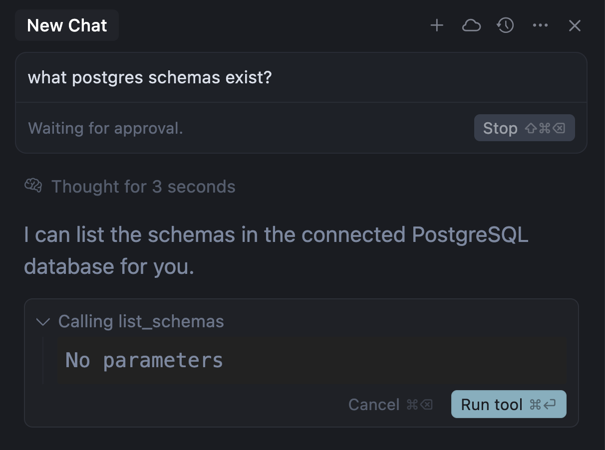
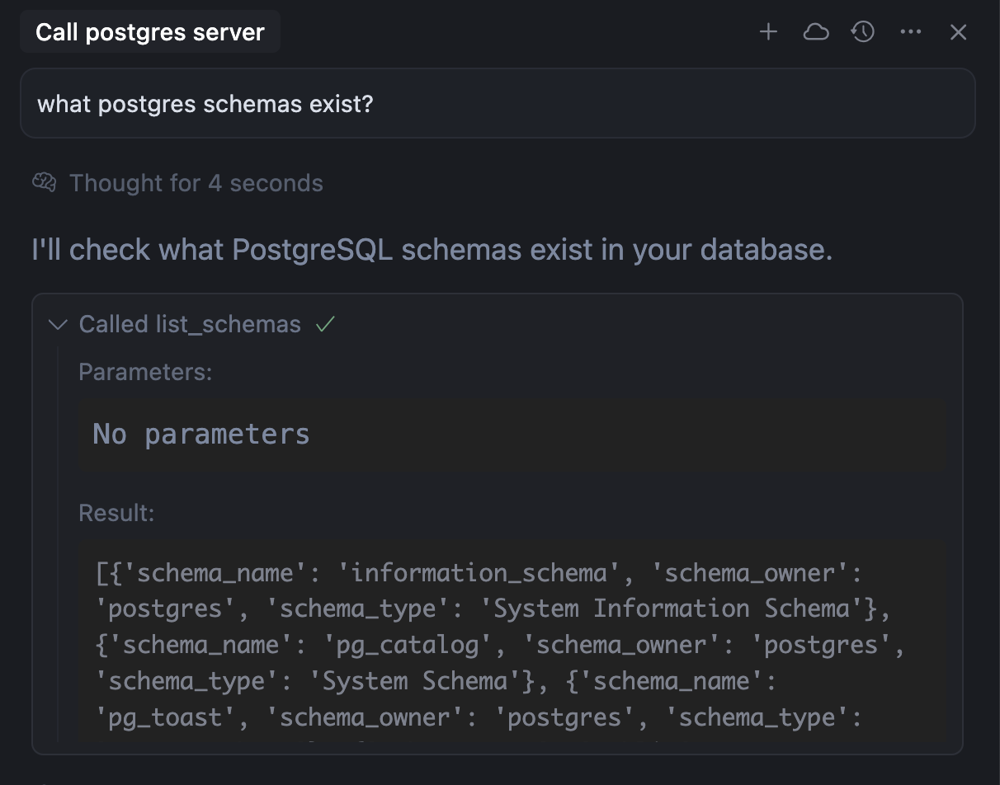

# Nano Banana by Ace Data Cloud for Cursor

This independent **Nano Banana by Ace Data Cloud** integration brings image generation, image editing and task retrieval into Cursor Agent. It is maintained by Ace Data Cloud, not an official plugin from the model brand or Cursor. The hosted MCP connection avoids running a local server; your service API token is entered once in Configure.

Generate Nano Banana images and retrieve the finished image. This standalone plugin reuses the [Ace Data Cloud nanobanana MCP](https://github.com/AceDataCloud/MCPs/tree/main/nanobanana) and includes a focused Agent skill. Available tools and limits come from the live MCP schema.

[简体中文教程](readme/README_zh_Hans.md) · [Copyable first-run prompt](examples/first-run.md) · [Current pricing](https://platform.acedata.cloud/models?utm_source=opensource&utm_medium=referral&utm_campaign=evergreen&utm_content=nano_banana_cursor_shared_readme_pricing_en)

## 1. Find the independent Nano Banana plugin

In [Cursor Marketplace](https://cursor.com/marketplace) or **Customize**, search for **Nano Banana by Ace Data Cloud**. If the entry from **Ace Data Cloud Dev** is available, select **Install**.

To load a standalone copy, download **Source code (zip)** from the [v1.0.1 release](https://github.com/AceDataCloud/NanoBananaCursor/releases/tag/v1.0.1). Copy the contents of the extracted plugin folder, including its hidden `.cursor-plugin` directory, into `~/.cursor/plugins/local/nano-banana/`. Run **Developer: Reload Window**. Local imports must be allowed. Use one copy in the editor to avoid duplicate tools. [Cursor local installation instructions](https://cursor.com/docs/plugins#test-plugins-locally)

## 2. Register or sign in and get a service API token

1. [Open Ace Data Cloud](https://platform.acedata.cloud/?utm_source=opensource&utm_medium=referral&utm_campaign=evergreen&utm_content=nano_banana_cursor_shared_readme_register_signin_en) and register or sign in. Then open [Applications](https://platform.acedata.cloud/console/applications?utm_source=opensource&utm_medium=referral&utm_campaign=evergreen&utm_content=nano_banana_cursor_shared_readme_api_key_en). If no General application exists, select **Initialize General Application**.
2. Open **General application** or an application enabled for **Nano Banana**. Confirm service access, balance and [current pricing](https://platform.acedata.cloud/models?utm_source=opensource&utm_medium=referral&utm_campaign=evergreen&utm_content=nano_banana_cursor_shared_readme_pricing_en) before any generation.
3. Copy an existing API Key with the copy button marked **1** below, or open **Manage Keys** marked **2**, then **Create** for a dedicated Cursor token.


4. Name the optional key, for example **Cursor Nano Banana**. Set expiry and usage/API limits as needed; create it and copy the token. The screenshot's **Dify tutorial** name is a historical example only; use your Cursor-specific name. If Allowed APIs is enabled, allow the actions needed here: `/nano-banana/images`, `/nano-banana/tasks`.


These are real Ace Applications screenshots reused from the [Suno Dify tutorial](https://github.com/AceDataCloud/SunoDify/blob/8d3d03570e73324220f111f7fe343da0792a8071/README.md), checked on **2026-10-18**; original capture date is not recorded. Key, application ID and balance are obscured. They show Ace credential management, not a Dify step required for Cursor.

Copy only the service token string: no `Bearer ` prefix, quotation marks or redacted screenshot characters. This is not a platform management token. Never put a token in prompts, source, screenshots or exported examples.

## 3. Paste the token in Cursor Configure

Open **Customize → Plugins → Nano Banana by Ace Data Cloud → Configure** (older versions may show **Nano Banana**). Paste the token in **Ace Data Cloud API token**, choose **Save**, wait for completion, then reopen Configure to confirm a masked value. Cursor substitutes `ACEDATACLOUD_API_TOKEN`; the plugin adds `Bearer ` and connects to its hosted HTTP MCP. No Python or Node server needs to be started. Reconnect if tools have not loaded.

The Configure path and variable behavior follow the [official Cursor plugin reference](https://cursor.com/docs/reference/plugins#variables), checked **2026-10-18**. The screenshots below show Cursor’s tool approval and result views.

```json
{
  "mcpServers": {
    "nanobanana": {
      "type": "http",
      "url": "https://nanobanana.mcp.acedata.cloud/mcp",
      "headers": {
        "Authorization": "Bearer ${ACEDATACLOUD_API_TOKEN}"
      }
    }
  }
}
```

## 4. Run the first example

Open Cursor Agent and paste the [first-run prompt](examples/first-run.md). It asks for `nanobanana_generate_image`, model `nano-banana-2-lite` and resolution 1K, aspect_ratio 1:1, count 1. The sample prompt is `A teal ceramic cube on a plain cream background, studio product photograph, no text.`. Verify live model access and price before running.

Submit with `nanobanana_generate_image` once. Save the returned `task_id` and use `nanobanana_get_task` with that same ID until terminal. Pending is not a completed image; open the returned result URL on success. Never regenerate merely to poll.

Open the returned image and inspect it. In **Ace Data Cloud → Usage/Billing**, match this call to its deducted Credits record. The plugin is free; API calls follow current service pricing.

## 5. Confirm one tool call and inspect the result

For a free first connection check, open Agent and ask **“List this plugin's tools without generating anything.”** Then inspect the live schema for `nanobanana_generate_image` to see available model values. Confirm model access and current price before explicitly approving a new generation. Keep generation retries off; if a request times out, inspect the existing task and usage before deciding whether to pay again.

The following are **unaltered official Cursor screenshots**, downloaded/checked **2026-10-17**. The original example queries PostgreSQL, not Ace; the official page does not state its client version or capture date. They illustrate where to inspect the tool name/arguments and click **Run tool**, then inspect a returned result. They do not prove this plugin has been installed or run.





After an approved generation, query `nanobanana_get_task` with **`task_id` set to the original task ID**. For example: “Only call `nanobanana_get_task` with `task_id=<my_task_id>`; do not generate again.” Check completion and open your actual returned media URL. An accepted/pending task, a green tool indicator or an example link is not a finished, playable result. Check the corresponding single generation record in Ace Usage/Billing; Cursor/model auxiliary charges are separate.

Screenshot sources, checksums and reuse boundaries: [image provenance](assets/tutorial/SOURCES.json).

## Troubleshooting

| Symptom | Action |
| --- | --- |
| Plugin or tools are missing | Check the Nano Banana listing, configure the key, and reconnect MCP. |
| 401 or 403 | Check key validity, service access, balance, and Allowed APIs; do not include `Bearer ` in the configured value. |
| Invalid model or argument | Use the live tool schema and a model this account can access. |
| Pending task | Query the original task ID; do not regenerate to poll. |
| 429, timeout, or 5xx | Inspect the original task and usage history before another paid submission. |
| Result URL will not open | Confirm a terminal success and use the URL returned by that call. |

[Source](https://github.com/AceDataCloud/NanoBananaCursor) · [Report a problem](https://github.com/AceDataCloud/NanoBananaCursor/issues) · dev@acedata.cloud. The logo reuses an existing Ace Data Cloud integration asset. This tool plugin does not register a Cursor chat-model provider.

[Register / sign in](https://platform.acedata.cloud/?utm_source=opensource&utm_medium=referral&utm_campaign=evergreen&utm_content=nano_banana_cursor_shared_readme_register_signin_en) · [Applications / API token](https://platform.acedata.cloud/console/applications?utm_source=opensource&utm_medium=referral&utm_campaign=evergreen&utm_content=nano_banana_cursor_shared_readme_api_key_en) · [Current Nano Banana pricing](https://platform.acedata.cloud/models?utm_source=opensource&utm_medium=referral&utm_campaign=evergreen&utm_content=nano_banana_cursor_shared_readme_pricing_en)
