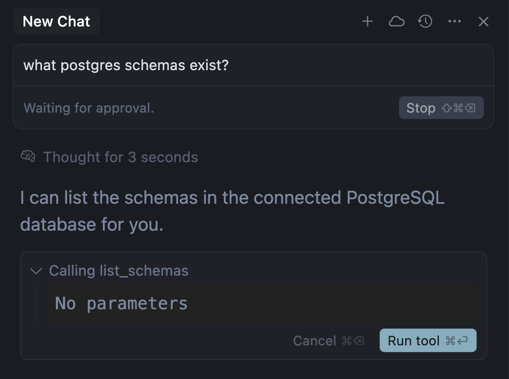

# Seedance by Ace Data Cloud for Cursor

This independent **Seedance by Ace Data Cloud** integration brings text-to-video, image-to-video and task retrieval into Cursor Agent. It is maintained by Ace Data Cloud, not an official plugin from the model brand or Cursor. The hosted MCP connection avoids running a local server; your service API token is entered once in Configure.

Generate Seedance videos and retrieve the finished clip. This standalone plugin reuses the [Ace Data Cloud seedance MCP](https://github.com/AceDataCloud/MCPs/tree/main/seedance) and includes a focused Agent skill. Available tools and limits come from the live MCP schema.

[简体中文教程](readme/README_zh_Hans.md) · [Copyable first-run prompt](examples/first-run.md) · [Current pricing](https://platform.acedata.cloud/models?utm_source=opensource&utm_medium=referral&utm_campaign=evergreen&utm_content=seedance_cursor_shared_readme_pricing_en)

## 1. Find the independent Seedance plugin

Open the [Cursor Marketplace](https://cursor.com/marketplace) or **Customize** in Cursor. Search **Seedance** (seedance, video generation, text to video), then look for **Seedance by Ace Data Cloud** and publisher/author **Ace Data Cloud Dev**. Select **Install** and choose the project or user scope. Cursor 3.24 used **Customize → Browse Marketplace → Add**; use the controls in your installed version. Installing this plugin does not require an Ace collection plugin.

**Publication status:** [the official submission](https://github.com/cursor/plugins/pull/549) is pending review; an available source repository or a passing check does not prove a live Marketplace listing. If the exact listing is absent, do not install a similarly named unrelated plugin. An optional source/local review under `~/.cursor/plugins/local/seedance/` is a manual route, not official distribution. This is a tool integration, not an Ace preset in Cursor's chat-model provider list.

For an unpublished candidate, use the [pinned local-review procedure](docs/local-review.md) rather than guessing a Marketplace URL. It copies the tracked candidate files, checks for an existing installation, and records the exact commit. Local loading needs a reload and allowed local imports; an external-repository symlink is skipped, and a same-name Marketplace install takes precedence. This procedure does not claim official installation.

## 2. Register or sign in and get a service API token

1. [Open Ace Data Cloud](https://platform.acedata.cloud/?utm_source=opensource&utm_medium=referral&utm_campaign=evergreen&utm_content=seedance_cursor_shared_readme_register_signin_en) and register or sign in. Then open [Applications](https://platform.acedata.cloud/console/applications?utm_source=opensource&utm_medium=referral&utm_campaign=evergreen&utm_content=seedance_cursor_shared_readme_api_key_en). If no General application exists, select **Initialize General Application**.
2. Open **General application** or an application enabled for **Seedance**. Confirm service access, balance and [current pricing](https://platform.acedata.cloud/models?utm_source=opensource&utm_medium=referral&utm_campaign=evergreen&utm_content=seedance_cursor_shared_readme_pricing_en) before any generation.
3. Copy an existing API Key with the copy button marked **1** below, or open **Manage Keys** marked **2**, then **Create** for a dedicated Cursor token.


4. Name the optional key, for example **Cursor Seedance**. Set expiry and usage/API limits as needed; create it and copy the token. The screenshot's **Dify tutorial** name is a historical example only; use your Cursor-specific name. If Allowed APIs is enabled, allow the actions needed here: `/seedance/videos`, `/seedance/tasks`.


These are real Ace Applications screenshots reused from the [Suno Dify tutorial](https://github.com/AceDataCloud/SunoDify/blob/8d3d03570e73324220f111f7fe343da0792a8071/README.md), checked on **2026-10-18**; original capture date is not recorded. Key, application ID and balance are obscured. They show Ace credential management, not a Dify step required for Cursor.

Copy only the service token string: no `Bearer ` prefix, quotation marks or redacted screenshot characters. This is not a platform management token. Never put a token in prompts, source, screenshots or exported examples.

## 3. Paste the token in Cursor Configure

Open **Customize → Plugins → Seedance by Ace Data Cloud → Configure** (older versions may show **Seedance**). Paste the token in **Ace Data Cloud API token**, choose **Save**, wait for completion, then reopen Configure to confirm a masked value. Cursor substitutes `ACEDATACLOUD_API_TOKEN`; the plugin adds `Bearer ` and connects to its hosted HTTP MCP. No Python or Node server needs to be started. Reconnect if tools have not loaded.

The Configure path and variable behavior follow the [official Cursor plugin reference](https://cursor.com/docs/reference/plugins#variables), checked **2026-10-18**. A current Ace-specific Configure screenshot is still pending; the official screenshots below illustrate the subsequent tool approval/result UI, not this token field.

```json
{
  "mcpServers": {
    "seedance": {
      "type": "http",
      "url": "https://seedance.mcp.acedata.cloud/mcp",
      "headers": {
        "Authorization": "Bearer ${ACEDATACLOUD_API_TOKEN}"
      }
    }
  }
}
```

## 4. Run the first example

Open Cursor Agent and paste the [first-run prompt](examples/first-run.md). It asks for `seedance_generate_video`, model `doubao-seedance-2-0-mini-260615` and duration 4 seconds, resolution 480p, ratio 16:9, generate_audio false. The sample prompt is `A teal paper cube slowly rotates on a cream studio background. Static camera, no text.`. Verify live model access and price before running.

Submit with `seedance_generate_video` once. Save the returned `task_id` and use `seedance_get_task` with that same ID until terminal. Pending is not a completed video; open the returned result URL on success. Never regenerate merely to poll.

Open the returned video and inspect it. In **Ace Data Cloud → Usage/Billing**, match this call to its deducted Credits record. The plugin is free; API calls follow current service pricing.

## 5. Confirm one tool call and inspect the result

For a free first connection check, open Agent and ask **“List this plugin's tools without generating anything.”** Then use `seedance_list_models` to inspect available models. Confirm model access and current price before explicitly approving a new generation. Keep generation retries off; if a request times out, inspect the existing task and usage before deciding whether to pay again.

The following are **unaltered official Cursor screenshots**, downloaded/checked **2026-10-17**. The original example queries PostgreSQL, not Ace; the official page does not state its client version or capture date. They illustrate where to inspect the tool name/arguments and click **Run tool**, then inspect a returned result. They do not prove this plugin has been installed or run.




After an approved generation, query `seedance_get_task` with **`task_id` set to the original task ID**. For example: “Only call `seedance_get_task` with `task_id=<my_task_id>`; do not generate again.” Check completion and open your actual returned media URL. An accepted/pending task, a green tool indicator or an example link is not a finished, playable result. Check the corresponding single generation record in Ace Usage/Billing; Cursor/model auxiliary charges are separate.

Screenshot sources, checksums and reuse boundaries: [image provenance](assets/tutorial/SOURCES.json).

## Troubleshooting

| Symptom | Action |
| --- | --- |
| Plugin or tools are missing | Check the Seedance listing, configure the key, and reconnect MCP. |
| 401 or 403 | Check key validity, service access, balance, and Allowed APIs; do not include `Bearer ` in the configured value. |
| Invalid model or argument | Use the live tool schema and a model this account can access. |
| Pending task | Query the original task ID; do not regenerate to poll. |
| 429, timeout, or 5xx | Inspect the original task and usage history before another paid submission. |
| Result URL will not open | Confirm a terminal success and use the URL returned by that call. |

[Source](https://github.com/AceDataCloud/SeedanceCursor) · [Report a problem](https://github.com/AceDataCloud/SeedanceCursor/issues) · dev@acedata.cloud. The logo reuses an existing Ace Data Cloud integration asset. This tool plugin does not register a Cursor chat-model provider.

[Register / sign in](https://platform.acedata.cloud/?utm_source=opensource&utm_medium=referral&utm_campaign=evergreen&utm_content=seedance_cursor_shared_readme_register_signin_en) · [Applications / API token](https://platform.acedata.cloud/console/applications?utm_source=opensource&utm_medium=referral&utm_campaign=evergreen&utm_content=seedance_cursor_shared_readme_api_key_en) · [Current Seedance pricing](https://platform.acedata.cloud/models?utm_source=opensource&utm_medium=referral&utm_campaign=evergreen&utm_content=seedance_cursor_shared_readme_pricing_en)
