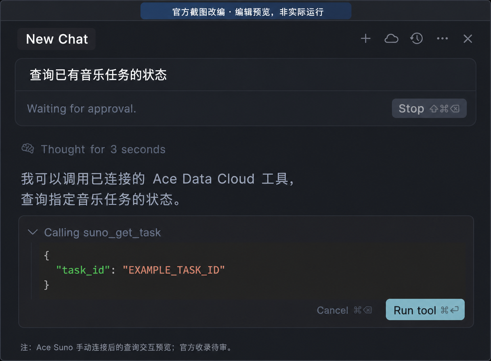

# Suno by Ace Data Cloud for Cursor

This independent **Suno by Ace Data Cloud** integration brings music, lyrics, audio edits and task retrieval into Cursor Agent. It is maintained by Ace Data Cloud, not an official plugin from the model brand or Cursor. The hosted MCP connection avoids running a local server; your service API token is entered once in Configure.

Generate Suno music in Cursor through the [Ace Data Cloud](https://platform.acedata.cloud?utm_source=opensource&utm_medium=referral&utm_campaign=evergreen&utm_content=suno_cursor_shared_readme_platform_en) hosted MCP server. The plugin provides Suno's music, lyrics, audio editing, and task-query tools, plus a short skill for safe async use. The hosted tool schemas determine the available actions and models.

[简体中文教程](readme/README_zh_Hans.md) · [Copyable first-run prompt](examples/first-song.md) · [Current pricing](https://platform.acedata.cloud/models?utm_source=opensource&utm_medium=referral&utm_campaign=evergreen&utm_content=suno_cursor_shared_readme_pricing_en)

## 1. Find the independent Suno plugin

Open the [Cursor Marketplace](https://cursor.com/marketplace) or **Customize** in Cursor. Search **Suno** (suno, music, music generation), then look for **Suno by Ace Data Cloud** and publisher/author **Ace Data Cloud Dev**. Select **Install** and choose the project or user scope. Cursor 3.24 used **Customize → Browse Marketplace → Add**; use the controls in your installed version. Installing this plugin does not require an Ace collection plugin.

**Publication status:** [the official submission](https://github.com/cursor/plugins/pull/547) is pending review; an available source repository or a passing check does not prove a live Marketplace listing. If the exact listing is absent, do not install a similarly named unrelated plugin. An optional source/local review under `~/.cursor/plugins/local/suno/` is a manual route, not official distribution. This is a tool integration, not an Ace preset in Cursor's chat-model provider list.

## 2. Register or sign in and get a service API token

1. [Open Ace Data Cloud](https://platform.acedata.cloud/?utm_source=opensource&utm_medium=referral&utm_campaign=evergreen&utm_content=suno_cursor_shared_readme_register_signin_en) and register or sign in. Then open [Applications](https://platform.acedata.cloud/console/applications?utm_source=opensource&utm_medium=referral&utm_campaign=evergreen&utm_content=suno_cursor_shared_readme_api_key_en). If no General application exists, select **Initialize General Application**.
2. Open **General application** or an application enabled for **Suno**. Confirm service access, balance and [current pricing](https://platform.acedata.cloud/models?utm_source=opensource&utm_medium=referral&utm_campaign=evergreen&utm_content=suno_cursor_shared_readme_pricing_en) before any generation.
3. Copy an existing API Key with the copy button marked **1** below, or open **Manage Keys** marked **2**, then **Create** for a dedicated Cursor token.


4. Name the optional key, for example **Cursor Suno**. Set expiry and usage/API limits as needed; create it and copy the token. The screenshot's **Dify tutorial** name is a historical example only; use your Cursor-specific name. If Allowed APIs is enabled, allow the actions needed here: `/suno/audios`, `/suno/tasks`.


These are real Ace Applications screenshots reused from the [Suno Dify tutorial](https://github.com/AceDataCloud/SunoDify/blob/8d3d03570e73324220f111f7fe343da0792a8071/README.md), checked on **2026-10-18**; original capture date is not recorded. Key, application ID and balance are obscured. They show Ace credential management, not a Dify step required for Cursor.

Copy only the service token string: no `Bearer ` prefix, quotation marks or redacted screenshot characters. This is not a platform management token. Never put a token in prompts, source, screenshots or exported examples.

## 3. Paste the token in Cursor Configure

Open **Customize → Plugins → Suno by Ace Data Cloud → Configure** (older versions may show **Suno**). Paste the token in **Ace Data Cloud API token**, choose **Save**, wait for completion, then reopen Configure to confirm a masked value. Cursor substitutes `ACEDATACLOUD_API_TOKEN`; the plugin adds `Bearer ` and connects to its hosted HTTP MCP. No Python or Node server needs to be started. Reconnect if tools have not loaded.

The Configure path and variable behavior follow the [official Cursor plugin reference](https://cursor.com/docs/reference/plugins#variables), checked **2026-10-18**. A current Ace-specific Configure screenshot is still pending; the official screenshots below illustrate the subsequent tool approval/result UI, not this token field.

```json
{
  "mcpServers": {
    "suno": {
      "type": "http",
      "url": "https://suno.mcp.acedata.cloud/mcp",
      "headers": {"Authorization": "Bearer ${ACEDATACLOUD_API_TOKEN}"}
    }
  }
}
```

## 4. Make and retrieve the first song

Open an Agent chat and paste the [first-song prompt](examples/first-song.md). It asks the agent to check available models and price, call `suno_generate_music` **once**, then use `suno_get_task` with the returned `task_id`. `chirp-v6` is an example only if it appears in the live model list; use a model your account can access.

The generation call can return an accepted task while its audio is still pending. Keep the task ID. If Cursor stops or the task remains pending, start a new chat and say: “Use `suno_get_task` to check task `<task_id>`; do not generate a new song.” A completed response contains playable audio URLs. Open an actual returned URL and check the file plays before treating the run as finished.

Task queries use the same ID and do not submit a second generation. Check **Ace Data Cloud → Usage/Billing** for the single generation record and its deducted Credits; the plugin itself is free, and API usage follows current service pricing.

## 5. Confirm one tool call and inspect the result

For a free first connection check, open Agent and ask **“List this plugin's tools without generating anything.”** Then use `suno_list_models` to inspect available models. Confirm model access and current price before explicitly approving a new generation. Keep generation retries off; if a request times out, inspect the existing task and usage before deciding whether to pay again.

The following are **unaltered official Cursor screenshots**, downloaded/checked **2026-10-17**. The original example queries PostgreSQL, not Ace; the official page does not state its client version or capture date. They illustrate where to inspect the tool name/arguments and click **Run tool**, then inspect a returned result. They do not prove this plugin has been installed or run.


After an approved generation, query `suno_get_task` with **`task_id` set to the original task ID**. For example: “Only call `suno_get_task` with `task_id=<my_task_id>`; do not generate again.” Check completion and open your actual returned media URL. An accepted/pending task, a green tool indicator or an example link is not a finished, playable result. Check the corresponding single generation record in Ace Usage/Billing; Cursor/model auxiliary charges are separate.



**Official-original edit preview, 2026-10-17; not an actual Ace execution or Marketplace publication.** `EXAMPLE_TASK_ID` is a placeholder. The preview was produced centrally from the official approval screenshot and does not show a returned audio result.

Screenshot sources, checksums and reuse boundaries: [image provenance](assets/tutorial/SOURCES.json).

## Troubleshooting

| Symptom | Action |
| --- | --- |
| Plugin or tools are missing | Confirm the correct Suno listing is installed, configure the key, then reconnect the MCP server. A local copy is separate from the public Marketplace. |
| 401 or 403 | Check the full key, expiration, Suno access, balance, and allowed generation/retrieval APIs. Do not include `Bearer ` in the configured value. If the same key works through the Ace API but Cursor still reports an invalid token, confirm Save finished and restart Cursor before retrying a read-only task query. |
| Invalid model or argument | Ask `suno_list_models` and use the live tool schema. Models and limits can change. |
| Pending task | Query the original task ID again. Do not rerun generation to poll. |
| 429, timeout, or 5xx | Wait and inspect the original task or usage history before deciding whether another paid submission is needed. |
| Audio URL will not open | Confirm the task succeeded and use the URL returned by that completed task. |

The exact Suno MCP server and package source are maintained in [AceDataCloud/MCPs](https://github.com/AceDataCloud/MCPs/tree/main/suno). Report a plugin issue at [SunoCursor issues](https://github.com/AceDataCloud/SunoCursor/issues) with the task ID or trace ID, never your key. The logo reuses the existing Ace Data Cloud Suno integration asset.

This is a tool plugin. It does not register a Cursor chat-model provider.

[Register / sign in](https://platform.acedata.cloud/?utm_source=opensource&utm_medium=referral&utm_campaign=evergreen&utm_content=suno_cursor_shared_readme_register_signin_en) · [Applications / API token](https://platform.acedata.cloud/console/applications?utm_source=opensource&utm_medium=referral&utm_campaign=evergreen&utm_content=suno_cursor_shared_readme_api_key_en) · [Current Suno pricing](https://platform.acedata.cloud/models?utm_source=opensource&utm_medium=referral&utm_campaign=evergreen&utm_content=suno_cursor_shared_readme_pricing_en)
